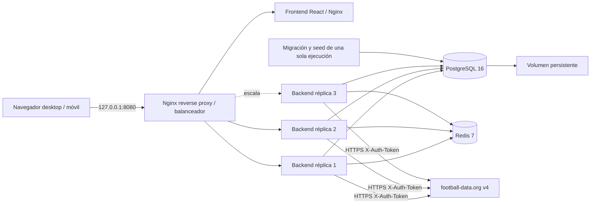
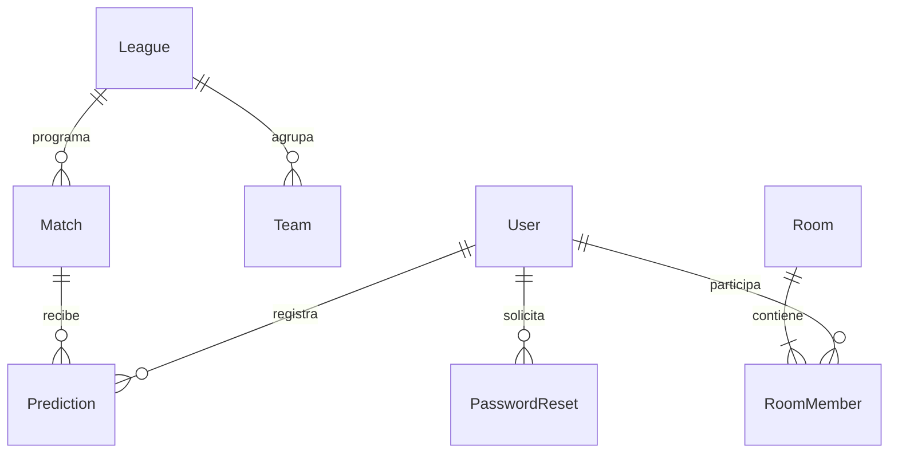

# Entregable 1 — Arquitectura local

La infraestructura corre en la VM Linux de Docker Desktop sobre el equipo local. No se crea infraestructura remota. Este enfoque adapta el laboratorio de instancias virtualizadas a la instrucción explícita del usuario de no utilizar AWS.

Nginx sirve como única entrada. Frontend es estático; API usa cookies HttpOnly/SameSite y JWT firmado de ocho horas. `tokenVersion` en PostgreSQL invalida sesiones al cerrar o cambiar contraseña. Argon2 almacena hashes. El administrador controla importación y correcciones; el usuario no puede escribir puntos. Zod valida entradas, Prisma parametriza SQL, React escapa texto y CSP limita recursos. El HTTP sin TLS se restringe a loopback en esta entrega.

Redis comparte caché, límites y pausas del proveedor. No es almacén definitivo de puntos ni sesiones. Reiniciarlo pierde caché y enlaces de recuperación locales, pero no usuarios, pronósticos ni resultados. PostgreSQL concentra persistencia. Las operaciones críticas adquieren un advisory lock transaccional para evitar carreras entre cierre, edición y corrección. La unicidad usuario/partido evita duplicados.

## Modelo entidad-relación

Tablas implementadas y migradas: User, League, Team, Match, Prediction, Room, RoomMember, AuditLog y PasswordReset. `User.role` representa los roles USER/ADMIN; `League.season` representa temporada actual; `Prediction.points/breakdown/evaluated` son puntuación derivada; invitación es el código único de Room. Las estadísticas se agregan a demanda, evitando tablas duplicadas que puedan desincronizarse. La actividad se deriva de pronósticos y salas; no existe un sistema separado de notificaciones push. Los datos de plantilla del proveedor se conservan en `Team.data` JSON con su fuente. Los snapshots no implican alineación oficial.

PK UUID para entidades internas, IDs externos para partidos/equipos con prefijos `demo:`/`manual:` donde corresponde (los ejemplos históricos usan `demo-`). FK y restricciones definidas en `backend/prisma/schema.prisma`. Índice por fecha/competición, email único, código de sala único, miembro único por sala y usuario, pronóstico único por usuario y encuentro. Eliminación de sala aplica cascada a miembros. Auditoría registra actor, acción, fecha y contenido anterior/nuevo.

## Operación y observabilidad

Healthchecks en todos los servicios permanentes. Logs JSON de arranque, errores externos y fallos de solicitudes. Logs Nginx de acceso. Registro de sincronizaciones, importaciones y correcciones en AuditLog. `docker stats --no-stream` captura consumo real. No se incluyen Prometheus/Grafana: la evidencia se obtiene con CLI local y k6.

La arquitectura prioriza claridad del laboratorio sobre concurrencia masiva: el lock global de escritura simplifica determinismo, pero limita throughput de escrituras. Las pruebas de lectura no demuestran capacidad equivalente para registro o recálculos grandes.
